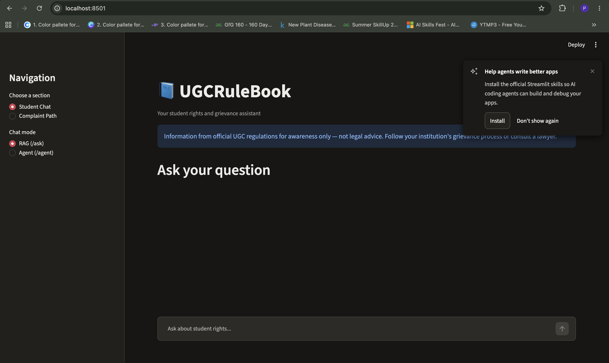

[](https://github.com/PriyankaAgwan30/Priyanka_GenAI_Training/actions/workflows/ci.yml)

# UGCRuleBook – UGC Student Rights Assistant

## 1. Product

UGCRuleBook is a student-rights information system that helps college students understand their rights under University Grants Commission (UGC) regulations, guidelines, and circulars.

Students can ask questions in simple language and get answers based on official UGC documents.

The project focuses on topics such as:
- Fee refunds after admission withdrawal
- Return of original certificates
- Ragging complaints
- Student grievance redressal
- Ombudsperson
- Sexual-harassment redressal

The main goal is to make important student-rights information easier to find and understand.

## 2. Target Users

UGCRuleBook is designed for:
- College students, especially first-year students
- Students who want to withdraw their admission
- Students facing problems with college fees or original certificates
- Students who want to understand how to submit a complaint against their institution

## 3. Problem Statement

Many students do not know their rights because official UGC regulations and notifications are lengthy and written in formal language.

Finding the correct information in these documents can take time and can be confusing.

For example, a student may get a better CAP seat after taking admission at another college. In such a situation, the student may face difficulties getting the admission fees refunded or original certificates returned.

UGCRuleBook aims to make this information easier to access by allowing students to ask questions and receive answers based on official documents.

## 4. Data Sources

The project uses UGC regulations and official documents as its information sources.

1. **UGC Student-Centric Regulations**

   https://www.ugc.gov.in/regulations/UGC_Regulations_Student_Centric

2. **UGC Regulation PDF**

   https://www.ugc.gov.in/pdfnews/4675881_Regulation.pdf

The project also uses relevant documents related to student grievances, ragging, and other student-rights topics.

## 5. Technologies Used

- **Python:** Main programming language
- **FastAPI:** Building API endpoints
- **Sentence Transformers:** Converting text into numerical embeddings
- **ChromaDB:** Storing document embeddings and retrieving relevant information
- **Google Gemini API:** Generating answers from retrieved information
- **PyPDF:** Extracting text from PDF documents
- **BeautifulSoup:** Extracting text from HTML documents

## 6. How the Project Works

UGCRuleBook uses Retrieval-Augmented Generation (RAG).

The working process is:

1. Load UGC PDF and HTML documents.
2. Extract and clean the text from these documents.
3. Divide the text into smaller parts called chunks.
4. Generate embeddings using the Sentence Transformers model.
5. Store the chunks and embeddings in ChromaDB.
6. When a student asks a question, retrieve the most relevant chunks.
7. Send the retrieved information to Google Gemini to generate an answer.
8. Return the answer along with source citations.

The system uses retrieved document information to answer questions. If the available documents do not contain enough information to answer a question, it responds with **"I don't know"** instead of making up an answer.

## 7. Project Structure

```text
UGCRuleBook/
│
├── app/
│   ├── chunking.py
│   ├── embed.py
│   ├── vectorstore.py
│   ├── llm.py
│   ├── rag.py
│   ├── records.py
│   ├── smart_search.py
│   ├── tools.py
│   ├── agent_loop.py
│   ├── graph.py
│   └── main.py
│
├── data/
│   ├── raw/
│   └── chroma_db/
│
├── eval/
│   ├── eval_set.json
│   ├── run_eval.py
│   ├── prompt_compare.md
│   └── search_results.md
│
├── analysis/
│   └── explore.py
│
├── requirements.txt
└── README.md
```

## 8. API Endpoints

The project provides API endpoints through FastAPI.

| Method | Endpoint | Purpose |
|---|---|---|
| GET | `/health` | Check whether the API is running |
| GET | `/records` | Display available student-rights records |
| GET | `/records/{id}` | Get a record using its ID |
| GET | `/search?q=...` | Search records using TF-IDF |
| POST | `/questions` | Submit a student question and find matching records |
| POST | `/ask` | Ask a question and receive a RAG-based answer with citations |
| POST | `/agent` | Run the LangGraph agent workflow with tool selection, approval, and memory |

### Example: POST /ask

Request:

```json
{
  "question": "Can a college withhold original certificates to force fee payment?"
}
```

The response contains:
- The student's question
- An answer generated using retrieved UGC information
- Citations showing the source documents and relevant pages

## 9. Day 8 – RAG Evaluation

To check how well the system retrieves relevant information, two configurations were tested using the same set of 15 questions.

The configurations used different chunk sizes, overlaps, and Top-K values.

### Configuration Comparison

| Evaluation Metric | A - Baseline | B - Alternative |
|---|---:|---:|
| Chunk Size | 800 | 500 |
| Chunk Overlap | 150 | 100 |
| Top-K | 5 | 3 |
| Total Chunks | 161 | 261 |
| Keyword Coverage | 95.24% | 83.33% |
| Retrieval Hit Rate | 100% | 100% |
| Unsupported Question Rejection | 100% | 100% |

### Selected Configuration: A - Baseline

The baseline configuration performed better in the evaluation.

Selected settings:

- Chunk Size: 800
- Chunk Overlap: 150
- Top-K: 5

It achieved 95.24% keyword coverage while maintaining a 100% retrieval hit rate and 100% rejection rate for the unsupported question.

Therefore, Configuration A was selected for the project.

### Evaluation Dataset

- Total questions: 15
- Answerable questions: 14
- Unsupported questions: 1

The unsupported question checks whether the system correctly responds with "I don't know" when the answer is not available in the documents.

*Note: These results are from a keyword-based retrieval evaluation. They measure retrieval performance and unsupported-question handling, not the factual accuracy of every generated answer.*

## 10. How to Run the Project

### Step 1: Open the project folder

```bash
cd UGCRuleBook
```

### Step 2: Create a virtual environment

```bash
python3.12 -m venv myenv
```

### Step 3: Activate the virtual environment

```bash
source myenv/bin/activate
```

### Step 4: Install required packages

```bash
python -m pip install -r requirements.txt
```

### Step 5: Configure the Gemini API

Create a `.env` file in the project folder and add your Gemini configuration:

```text
LLM_PROVIDER=gemini
GEMINI_MODEL=gemini-3.5-flash-lite
GEMINI_API_KEY=your_gemini_api_key
```

Replace the placeholder with your own API key. Do not upload the `.env` file or share your API key publicly.

### Step 6: Start the FastAPI server

```bash
python -m uvicorn app.main:app --reload
```

### Step 7: Open the API documentation

Visit:

http://127.0.0.1:8000/docs

You can test the available API endpoints from the Swagger UI.

### Step 8: Run the data analysis

```bash
python -m analysis.explore
```

### Step 9: Run the RAG evaluation

```bash
PYTHONPATH=. python -u eval/run_eval.py
```

This runs both configurations and displays their evaluation results.

## 11. Project Goal

The goal of UGCRuleBook is to help students understand their rights without having to read lengthy official documents on their own.

By combining document retrieval and language generation, the project provides a simpler way to find information about UGC regulations and student-related issues.

The answers are based on available source documents, with citations to help students refer to the original information.
## 12. Day 9 – Agentic Workflow and LangGraph

Day 9 adds an agentic workflow to UGCRuleBook. The agent can select and use different tools depending on the student's question.

### 1. Tools

The project includes two tools:

- **RAG Search Tool:** Searches UGC documents and returns an answer with source citations.
- **Fee Refund Calculator:** Calculates the estimated refund amount using a configured refund policy, withdrawal date, and applicable deadlines.

The calculator supports:
- Calendar-based refund deadlines.
- The five-tier refund table from the 2018 UGC policy.

The applicable policy must be selected and verified before calculation. The calculator does not independently determine which regulator or academic-year policy legally applies.

### 2. Hand-Written Agent Loop

The file `app/agent_loop.py` implements a simple agent loop.

It checks the student's question and selects an appropriate tool:

1. Identify the student's question.
2. Check whether it is related to fee refunds.
3. Call the fee-refund calculator when the required inputs are provided.
4. Otherwise, call the RAG search tool.
5. Return the tool result.

### 3. LangGraph Workflow

The file `app/graph.py` rebuilds the agent workflow using LangGraph.

The workflow includes:

- Conditional routing to select the appropriate tool.
- An approval node before the fee-refund calculator.
- A memory node to save conversation history.
- A checkpointer using LangGraph's `MemorySaver`.

The fee-refund calculator runs only when approval is granted if approval is required.

Conversation memory is maintained using a thread ID. The current `MemorySaver` implementation stores memory in the running application process, so memory is cleared when the application restarts.

### 4. Day 9 Workflow

1. Student submits a question.
2. LangGraph identifies the appropriate workflow.
3. For fee-refund questions, the approval step is checked.
4. If approval is granted, the calculator runs.
5. For other questions, the RAG search tool retrieves relevant information.
6. The result is saved in conversation memory.
7. The API returns the result.

### 5. New API Endpoint

| Method | Endpoint | Purpose |
|---|---|---|
| POST | `/agent` | Run the LangGraph agent workflow with tool selection, approval, and memory |

### Example: POST /agent

Fee-refund request:

```json
{
  "question": "How much fee refund can I get?",
  "fee_paid": 95000,
  "admission_year": 2025,
  "withdrawal_date": "2025-10-20",
  "policy_type": "calendar_deadline",
  "full_refund_until": "2025-09-30",
  "max_deduction_until": "2025-10-31",
  "approval_required": true,
  "approved": true,
  "thread_id": "student1"
}

```

The response includes:
- The selected tool.
- The calculated refund amount.
- The policy clause used.
- Approval status.
- Conversation history.

The example dates and policy settings are supplied as test inputs. They do not establish an individual's legal refund entitlement.

### 6. Day 9 Testing

The following workflows were tested through the FastAPI endpoint:

| Test | Result |
|---|---|
| Fee-refund calculator through API | Passed |
| RAG tool selection through API | Passed |
| Conversation memory | Passed |
| Previous-question recall | Passed |
| Approval denied – calculator skipped | Passed |
| Approval granted – calculator executed | Passed |

## 13. Day 10 – Streamlit UI and Complaint Escalation

Day 10 adds a Streamlit user interface to make UGCRuleBook easier for students to use.

### 1. Streamlit Chat Interface

The application provides:
- A chat interface for asking student-rights questions.
- Integration with the FastAPI `/ask` and `/agent` endpoints.
- Answers supported by retrieved UGC documents.
- Source citations showing the document name and page number.
- Thumbs-up and thumbs-down feedback for responses.

### 2. Complaint Escalation Stepper

The application provides complaint guidance for four categories:

- Fee refund
- Ragging
- Harassment
- Examination marks

The escalation path helps students understand where to raise a grievance:

1. **College Students' Grievance Redressal Committee (SGRC):** Submit the complaint to the institution's committee.
2. **University Ombudsperson:** A student may appeal against the SGRC decision within 15 days of receiving it.
3. **UGC e-Samadhan / Helpline:** An additional channel for seeking assistance or reporting unresolved concerns.

### 3. Important UGC 2023 Timelines

According to the UGC (Redressal of Grievances of Students) Regulations, 2023:

| Process | Timeline |
|---|---|
| Institution forwards an online complaint to the SGRC | Within 15 days |
| SGRC sends its report and recommendations | Preferably within 15 working days |
| Student appeals against the SGRC decision | Within 15 days of receiving the decision |
| Ombudsperson works to resolve the appeal | Within 30 days of receiving it |

These timelines are based on Sections 5 and 8 of the regulations. The 30-day period is an obligation to make all efforts to resolve the grievance, not a guaranteed outcome.

### 4. Application Screenshot

The following screenshot shows the UGCRuleBook application interface.



### 5. How to Run the Streamlit Application

Start the FastAPI backend in one terminal:

```bash
source myenv/bin/activate
python -m uvicorn backend.main:app --reload
