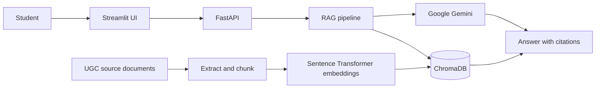

# UGCRuleBook

UGCRuleBook helps college students find plain-language information about
student rights in University Grants Commission (UGC) regulations and
circulars. It focuses on problems such as fee refunds, withheld certificates,
ragging, and student grievance procedures.

> **Awareness tool, not legal advice.** Rules may depend on the academic year,
   institution, regulator, and later circulars. Check the cited official
   source and your institution's process before acting.

## What it does

- Answers questions using retrieved UGC documents and returns source/page
  citations.
- Offers record search, semantic search, and an optional tool-based agent.
- Shows a complaint escalation guide in the Streamlit UI.
- Includes 20 curated sample rights records and source documents in `data/raw/`.

The target user is a student trying to understand their options—for example,
someone who leaves a college after receiving another admission offer and is
trying to recover fees or original certificates.

## Architecture



Documents in `data/raw/` are extracted and chunked when the Docker image is
built. Their embeddings and the ChromaDB index are stored in the image. Rebuild
the image after changing source documents. The initial build downloads the
embedding model and may take several minutes.

## Run locally

Requirements: Python 3.12, Tesseract OCR with English and Hindi data, and
Poppler utilities for scanned PDFs.

```bash
python3.12 -m venv .venv
source .venv/bin/activate
python -m pip install -r requirements.txt
cp .env.example .env
```

Set `GEMINI_API_KEY` in `.env`, then start the API:

```bash
python -m uvicorn backend.main:app --reload
```

Open [http://127.0.0.1:8000/docs](http://127.0.0.1:8000/docs) for interactive
API documentation. In another terminal, start the UI:

```bash
source .venv/bin/activate
UGCRULEBOOK_API_URL=http://127.0.0.1:8000 \
  streamlit run ui/app.py
```

The first request to `/ask` needs a valid Gemini API key. `/health` and record
endpoints do not call the language model.

The Gemini client uses a bounded timeout and one retry for temporary provider
errors. If Gemini remains unavailable, `/ask` returns the top retrieved source
excerpts with citations rather than an empty answer. Other LLM endpoints return
a clear provider error instead of an unhandled server error.

## Run with Docker Compose

Docker Compose builds one image for the API and UI, indexes the source
documents, and stores UI feedback in a named volume. It does not mount over
the image's ChromaDB index.

```bash
cp .env.example .env
# Add your Gemini API key to .env
docker compose up --build
```

- UI: [http://localhost:8501](http://localhost:8501)
- API: [http://localhost:8000](http://localhost:8000)
- API docs: [http://localhost:8000/docs](http://localhost:8000/docs)
- Health: [http://localhost:8000/health](http://localhost:8000/health)

To stop the services, run `docker compose down`. To also remove saved UI
feedback, run `docker compose down --volumes`.

## Deploy with Render

Create a **Docker** web service from this repository and use the root
`Dockerfile`. Configure these environment variables in the service settings:

| Variable | Value |
|---|---|
| `LLM_PROVIDER` | `gemini` |
| `GEMINI_MODEL` | `gemini-3.5-flash-lite` (or a model enabled for your API key) |
| `GEMINI_API_KEY` | Set as a secret; do not commit it |

The container listens on Render's `PORT` (defaulting to 8000 locally). Set the
service health-check path to `/health`. For a separately hosted Streamlit UI,
set `UGCRULEBOOK_API_URL` to the deployed API's base URL. The API's ChromaDB
index is part of the image, so rebuild and redeploy after updating documents.
The existing deployment URL in prior project notes did not respond during this
check; verify the deployed URL after publishing a new build.

## API

| Method | Path | Purpose |
|---|---|---|
| `GET` | `/health` | Liveness check |
| `GET` | `/records?limit=20` | List curated records |
| `GET` | `/records/{id}` | Fetch a record |
| `GET` | `/search?q=...` | Search curated records |
| `GET` | `/search/semantic?q=...` | Search indexed source chunks |
| `POST` | `/questions` | Find records matching a question |
| `POST` | `/ask` | Get a document-grounded answer and citations |
| `POST` | `/chat` | Get an LLM response using matching records |
| `POST` | `/agent` | Run the agent workflow |

Example `/ask` request:

```json
{
  "question": "Can a college withhold my original certificates?"
}
```

## Data and limitations

The project uses documents from the [UGC student-centric regulations
page](https://www.ugc.gov.in/regulations/UGC_Regulations_Student_Centric)
and the [UGC student grievance regulations
PDF](https://www.ugc.gov.in/pdfnews/4675881_Regulation.pdf), along with
related grievance, anti-ragging, and 2015 sexual-harassment regulation
documents in `data/raw/`. The harassment PDF is the official UGC source at
<https://www.ugc.gov.in/pdfnews/7203627_UGC_regulations-harassment.pdf>; it is
scanned, so text extraction uses OCR. Answers about ICC responsibilities and
complaint procedures cite the regulation section and Gazette page when the
retrieved text supports it. College-specific ICC contact details are not part
of this dataset; check the institution's official website or prospectus.

The supplied records and documents are a limited educational dataset, not a
complete or automatically updated statement of law. Fee refund cut-offs can
change by academic year; the calculator uses explicitly supplied policy dates
or the 2018 table and does not determine which regulator's policy applies.
Answers can be incomplete or wrong—confirm important details with the cited
source and relevant institution.

## Development checks

```bash
python -m pytest -q
ruff check .
```

Optional utilities:

```bash
python -m analysis.explore
python -m eval.run_eval
```

`analysis/` summarizes the curated records. The evaluation utility measures
retrieval metrics against `eval/eval_set.json`; it is not a legal or answer
accuracy certification.
