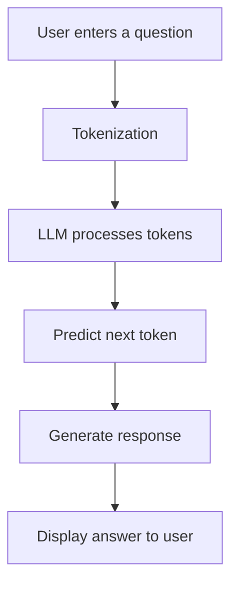

# How Large Language Models (LLMs) Work

## 1. What is an LLM?

A Large Language Model (LLM) is an AI model that understands and generates human language.

It is trained using a large amount of text data, such as books, articles, documents, and websites.

An LLM learns patterns in language. It uses these patterns to understand questions and generate meaningful answers.

Examples of LLMs include GPT, Llama, and Gemini.

## 2. How does an LLM work?

An LLM works through the following steps:

1. **Input:** The user enters a question or message.
2. **Tokenization:** The text is divided into smaller pieces called tokens.
3. **Processing:** The model processes these tokens and understands their context.
4. **Prediction:** The model predicts the next suitable token based on the previous tokens.
5. **Output:** The predicted tokens are combined to generate a response.

The model generates the response one token at a time.

## 3. Diagram: Working of an LLM

## 4. What is the role of LLMs in UGCRuleBook?

UGCRuleBook helps students understand their rights under UGC regulations.

For example, a student may ask:

"Can my college keep my original certificates if I withdraw my admission?"

The system can search its available UGC records to find relevant information.

An LLM can then help explain the retrieved information in simple language so that students can understand it.

## 5. What is the difference between an LLM and RAG?

**LLM:**
An LLM generates answers using patterns and knowledge learned during training.

**RAG (Retrieval-Augmented Generation):**
RAG first searches a collection of documents for relevant information. The retrieved information is then given to the LLM to help generate an answer.

RAG is useful when answers should be based on specific documents, such as UGC regulations.

## 6. Why is RAG useful for UGCRuleBook?

- It searches information from UGC regulations and circulars.
- It helps provide answers based on available documents.
- It reduces the need to manually read lengthy regulations.
- It can show students the relevant information from the source documents.

## 7. Limitations of LLMs

- An LLM can sometimes generate incorrect information.
- It may not know about recent changes unless updated information is provided.
- It cannot guarantee that every answer is correct.
- It should not make up information when the available data does not contain an answer.

UGCRuleBook should provide information based on its available records and clearly indicate when the required information is not available.